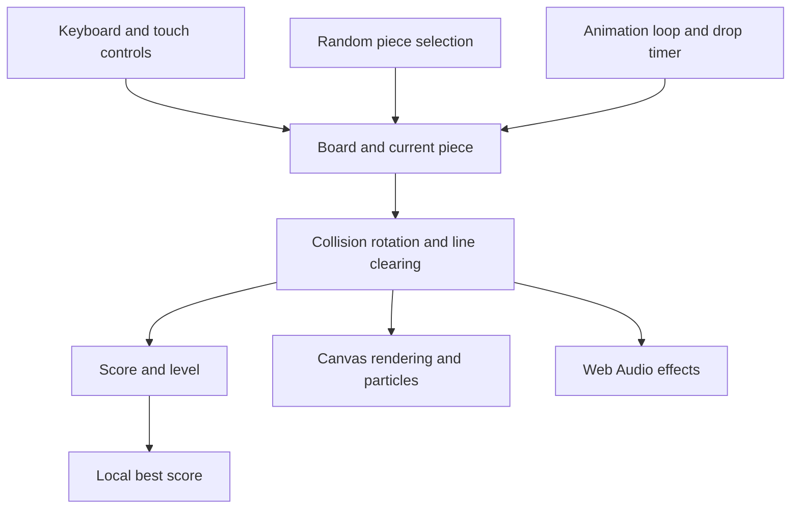

# Miaotris — jeu de blocs félin · Studio Niko Design

**Canvas 2D · Falling-block mechanics · Procedural sound effects**

[Source](index.html) · [Licence](LICENSE.md) · [English overview](#english-overview)

## Moteur de jeu

| Fonction de index.html | Algorithme |
| --- | --- |
| Plateau | Matrice de 10 colonnes × 20 lignes |
| rotate | Rotation matricielle de 90 degrés |
| collides / rotateCurrent | Contrôle des limites et cellules occupées, décalages horizontaux simples |
| randomType | Tirage indépendant via Math.random, pas de sac de sept pièces garanti |
| clearLines | Suppression de lignes complètes ; barème de 100/300/500/800 points multiplié par le niveau |
| Progression | Niveau augmenté toutes les dix lignes ; intervalle de chute borné à 80 ms |
| Rendu et audio | Canvas 2D, particules, effets sonores synthétisés via Web Audio |

Ce jeu utilise ses propres règles simplifiées ; il ne revendique pas la conformité aux règles officielles d'un jeu commercial. Le meilleur score est local, sans classement serveur établi.

## Ce que fait l'application, en pratique

**Miaotris** est un petit jeu de blocs à thème félin : déplacer les pièces à gauche ou à droite, **les faire tourner, accélérer leur chute**, puis recommencer une partie. Les commandes sont visibles dans l'interface web et un univers visuel complémentaire se trouve dans le dépôt.

**Statut :** expérience de jeu navigateur, sans garantie publiée de compatibilité avec tous les mobiles.

**Studio Niko Design** — Projet créatif interactif HTML.

## 🛠 Stack
`HTML` · `CSS` · `JavaScript`

## 👤 Auteur
**Nicolas Julienne** — [Studio Niko Design](https://github.com/Nikoju1977)
📧 nicolasjulienne.nj@gmail.com

---

## Utilisation et statut du projet

**Thème :** Jeux & création interactive.

L'expérience est contenue dans `index.html`, avec une icône et un manifeste. Ouvrir le fichier dans un navigateur ou lancer `python3 -m http.server 8000` pour une exploration locale. Le sous-dossier `alyina-vampire-of-halloween/` contient d'autres éléments créatifs.

**Statut :** expérience ludique / prototype navigateur. Aucun test de compatibilité mobile, accessibilité ou performance n'est attesté par cette mise à jour.

**Validation :** documentation basée sur les fichiers présents ; tests fonctionnels non exécutés lors de cette mise à jour.

[Catalogue des projets Studio Niko Design](https://github.com/Nikoju1977).

## Qualification proposée

Vérifier les rotations, collisions aux bords, suppression simultanée de lignes, score, pause, reprise, redémarrage et conservation du record sur données de test. Contrôler les commandes tactiles et clavier, la lisibilité, l'activation audio et les performances sur appareils représentatifs. Aucun test de jeu, d'accessibilité ou de déploiement exécuté ici.

## English overview

Miaotris is a cat-themed falling-block browser game. Its 10-by-20 board uses matrix rotation, basic horizontal collision kicks, independent random piece selection, line clearing and progressive gravity. Canvas draws the scene and Web Audio synthesizes effects. Best score is stored locally. No new runtime or device validation was performed.

[Notice de droits](LICENSE.md) : droits réservés pour les contributions originales concernées. Les droits tiers restent distincts.
